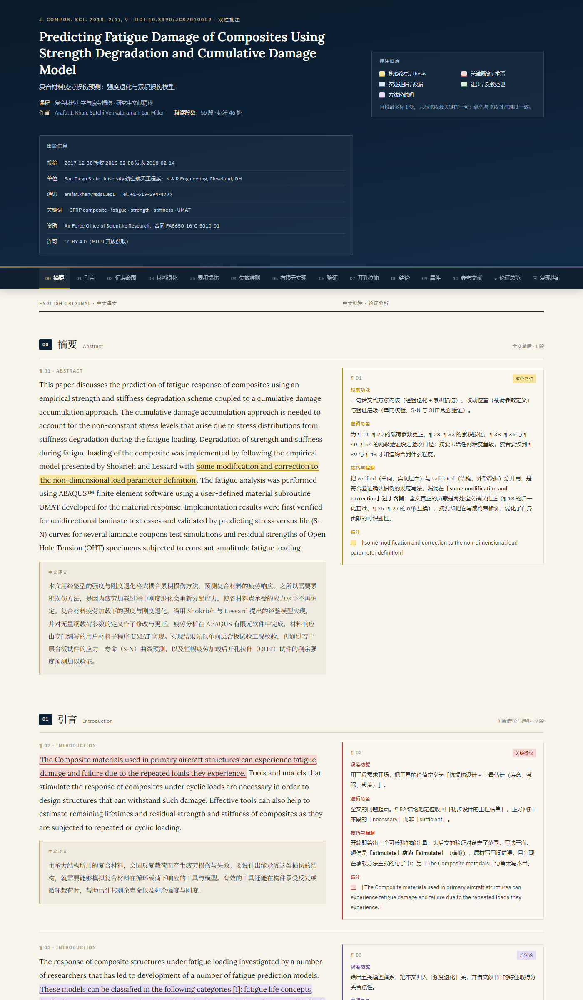
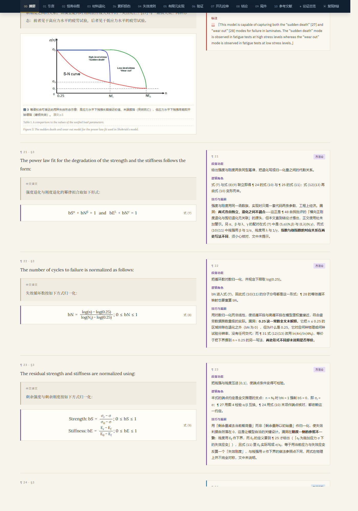
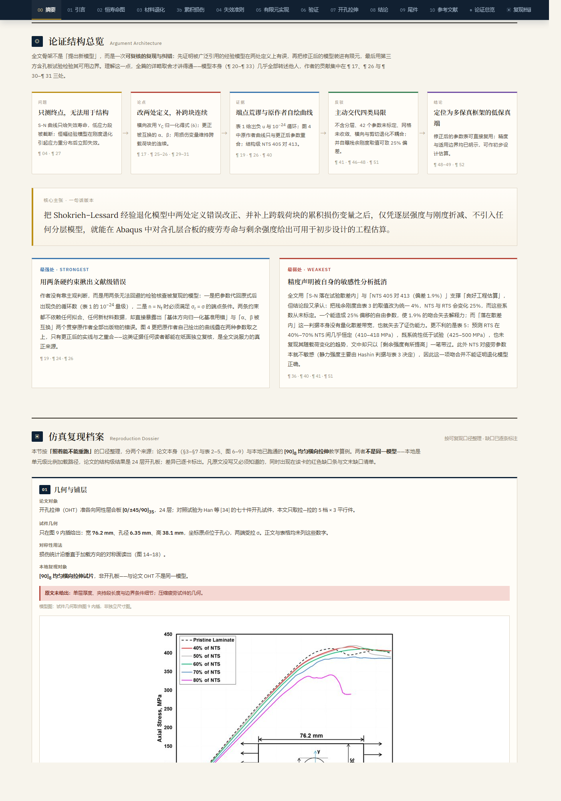
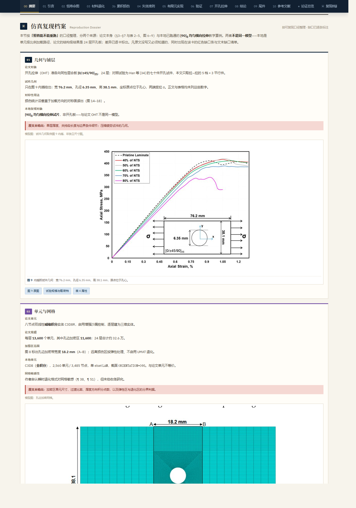

# paper-reading

把一篇学术论文 PDF 做成**单文件、可离线打开的双栏精读批注 HTML**。

左栏英文原文 + 中文意译，右栏逐段论证批注，原刊插图裁切内联、点击放大，底部是全文论证结构总览。一篇 50 段的论文最终只有一个 HTML 文件，双击就能读，不需要联网、不需要装任何东西。

---

## 一、这个技能从哪来

起点是 **X（推特）上一条公开分享的论文精读提示词**。原作者把"双栏批注"这套读论文的方法写成了一段可以直接粘给大模型的指令，内容就是下面这段（按原帖文字照录，含原有的分行与标点）：

```text
请将以下学术论文制作成一个完整的双栏批注HTML文件，重点呈现论文的论证结构与逻辑层次。
【文件要求】
输出单个 .html 文件，包含以下结构：
1. 顶部导航栏
- 标题：论文名 + 课程信息
- 颜色图例，对应以下分析维度：
• 黄色 = 核心论点/thesis
• 红色 = 关键概念/术语
• 蓝色 = 实证证据/数据
• 绿色 = 让步/反驳处理
• 紫色 = 方法论说明
2. 章节导航条（sticky，可跳转各节）
3. 主体内容：左右双栏布局
左栏：英中双语对照
• 每段按以下顺序呈现：
① 英文原文（Lora衬线字体）
按五类维度高亮标注关键内容
② 中文译文（紧接在英文段落下方，
浅米色背景块+左侧细竖线与英文区分）
- 意译为主，读起来像中文学术论文
- 不逐字直译，保持中文表达流畅
- 不加颜色高亮，保持干净
• 英中之间用 1px 细分隔线隔开
右栏：中文批注（逐段对应）
• 每段批注包含：
① 段落功能（如：引出问题/提供证据/反驳异议/总结）
② 逻辑角色（该段在整体论证链中的位置）
③ 值得注意的论证技巧或潜在漏洞
4. 底部论证结构总览
- 全文逻辑骨架（问题→论点→证据→反驳→结论）
- 作者核心主张一句话版本
- 论证最强处 vs 最弱处各一条
【设计风格】
- 深海军蓝导航栏 + 米白纸张底色
- 五类维度分色高亮
- 字体：正文 Lora，界面 IBM Plex Sans
- 中文译文块：浅米色背景(#f0ece2) + 左侧细竖线，
与英文原文视觉区分，同属左栏
- 批注卡片：左色边 + 浅背景
- 响应式（移动端单栏）
```

原文帖的账号已无法确证，所以这里不写具体 handle。如果你知道出处，欢迎提 Issue 补充。

### 从"一段提示词"到"一个技能"

那条提示词本身能出活，但每换一篇论文都会重新踩同样的坑：图注定位不准、扫描版没识别、公式被整段丢掉、表格消失、高亮颜色和批注维度对不上、分段写到一半上下文被截断。这个仓库把它固化成了一个可复用的技能包：**提示词保留为设计契约，缺的部分用脚本和校验器补上**。

| 原始提示词 | 本技能的做法 |
|---|---|
| 只描述成品长什么样 | 拆成 8 步工作流：提取 → 裁图 → 规划 → 分片写作 → 装配 → 校验 → 浏览器验收 → 清理 |
| 要求"高亮关键内容" | 收紧为**每段最多 1 处**，只标该段最关键的一句，颜色必须等于该段批注维度 |
| 没有提图片 | `pdf_figures.py` 按图注定位裁图，`inline_figs.py` 转 base64 内联，保证单文件离线 |
| 没有提公式与表格 | 纯 CSS 排公式（不引 MathJax），原刊表格照录，`check_html.py --strict-refs` 强制"引用到的式号/表号必须真的呈现" |
| 没有验收手段 | 结构校验器 FAIL 即退出码 1；无头浏览器按锚点截图，双栏对齐与窄屏单栏必须目视 |
| 一次生成整页 | 按章节分片写 `_partN.html` 再装配，避免长文写到一半断掉 |

---

## 二、产物长什么样

<table>
<tr><td align="center">
<br/>
<b>顶栏与摘要</b><br/>深海军蓝顶栏、五个标注维度的色例、出版信息；sticky 章节导航条固定在页面顶端
</td></tr>
<tr><td align="center">
<br/>
<b>双栏正文</b><br/>左栏英文原文（Lora 衬线）+ 浅米色译文块（左侧细竖线区分），右栏逐段批注卡（左色边 + 浅背景）
</td></tr>
<tr><td align="center">
<br/>
<b>论证结构总览</b><br/>问题 → 论点 → 证据 → 反驳 → 结论的逻辑骨架，一句话主张，论证最强处与最弱处各一条
</td></tr>
<tr><td align="center">
<br/>
<b>复现档案</b><br/>论文含数值仿真时自动追加：几何 / 网格 / 材料 / 子程序 / 求解 / 失效 / 结果 / 环境八张卡，缺的信息进缺口清单
</td></tr>
</table>

---

## 三、样例：Khan 2018

上面四张图来自同一份真实成品，读的是这篇：

> Arafat I. Khan, Satchi Venkataraman, Ian Miller.
> **Predicting Fatigue Damage of Composites Using Strength Degradation and Cumulative Damage Model.**
> *Journal of Composites Science*, 2018, 2(1), 9. DOI: [10.3390/jcs2010009](https://doi.org/10.3390/jcs2010009)
> 开放获取，CC BY 4.0。文中插图与原文版权归原作者，此处仅作技能效果展示。

它讨论 CFRP 层合板在疲劳载荷下的强度退化与累积损伤，给出了可写成 UMAT 的显式算法，因此成品里既有论证批注，也有复现档案。成品的实测规模：

| 项目 | 数量 |
|---|---|
| 章节 | 14（摘要、9 个正文章节、尾件、参考文献、论证总览、复现档案） |
| 精读段 | 55 |
| 逐段批注 | 55 张（段落功能 / 逻辑角色 / 技巧与漏洞 / 标注） |
| 分色高亮 | 46 处，覆盖 46/55 段，每段至多 1 处 |
| 内联原刊插图 | 26 张 |
| 显示公式 | 20 条，全部在正文呈现 |
| 原刊数据表 | 5 张，全部照录 |
| 复现档案卡 | 8 张，算法 6 步，缺口清单 14 条 |
| 成品体积 | 3.49 MB（单文件，图片已内联） |

结构校验器对该成品的结论：

```text
repro cards 8 | algo steps 6 | gaps 14 | links 57
rows 55 | notes 55 | figures 26 | imgs 26 | marks 46 | sections 14 | nav 14
marks by dim: t=8 r=7 b=11 g=8 p=12
highlight density: 46 marks over 46/55 rows (one per paragraph max)
equations 20 rendered / 20 cited | tables 5 rendered / 5 cited
size 3.49 MB
PASS structure balanced, pairing and anchors consistent
```

---

## 四、五维标注规则

颜色不是装饰，是判断：

| 颜色 | 维度 | 标什么 |
|---|---|---|
| 黄 | 核心论点 thesis | 作者要你接受的主张 |
| 红 | 关键概念 / 术语 | 定义了才有后文的词 |
| 蓝 | 实证证据 / 数据 | 试验、仿真、引用来的硬数字 |
| 绿 | 让步 / 反驳处理 | 作者主动承认的局限、预先挡掉的质疑 |
| 紫 | 方法论说明 | 怎么做的、为什么这么做 |

**每段只标一处**。一段标三处等于没标，颜色混用等于没有颜色。这条规则由 `check_html.py` 强制执行：超过 1 处、颜色与批注维度不符、`标注` 栏没有逐字引用被标片段，任一情况判 FAIL。

---

## 五、安装

技能是纯文本 + Python 脚本，不需要 pip 安装。

```bash
git clone https://github.com/IY724/paper-reading.git ~/.agents/skills/paper-reading
```

Windows 放进 `C:\Users\<你的用户名>\.agents\skills\paper-reading`。这个目录已在 Qoder 桌面端的技能扫描路径内，放进去就能用，不用建软链接。其他客户端请放进各自的技能目录。

## 六、用法

```text
/paper-reading path/to/paper.pdf
```

或者直接说"把这篇论文做成双栏精读页"。技能会在论文所在目录（或你指定的目录）工作，最后只留一个 `<paper>_annotated.html`，中间的 `_work/`、`figs/`、`_part*.html`、`_shots/` 全部删除。

也可以绕开技能，只跑脚本：

```bash
python scripts/pdf_text.py paper.pdf --out _work
python scripts/pdf_figures.py paper.pdf --list
python scripts/pdf_figures.py paper.pdf --out figs --page-shots
python scripts/inline_figs.py out.html --figs figs
python scripts/check_html.py out.html --strict-refs
python scripts/shoot.py out.html --at p01,overview --size 1400x2200 --out _shots
```

## 七、依赖

| 依赖 | 用途 |
|---|---|
| Python 3.10+ | 全部脚本 |
| PyMuPDF | 文本提取、图注定位、区域裁图 |
| Pillow | 图片转码、缩略图、截图空白检测 |
| matplotlib（可选） | 本地算例没留结果图时自绘，需中文字体 |
| Edge 或 Chrome | 无头锚点截图验收 |

## 八、文件结构

```text
paper-reading/
├── SKILL.md                    技能主文件：8 步工作流与写作纪律
├── scripts/
│   ├── pdf_text.py             逐页文本提取，UTF-8 安全，扫描页告警
│   ├── pdf_figures.py          图注定位 + 区域裁切，支持 --list/--rect/--page-shots
│   ├── inline_figs.py          图片转 base64 内联，残留引用检查
│   ├── check_html.py           结构校验器，FAIL 即退出码 1
│   └── shoot.py                Edge/Chrome 无头锚点截图
├── assets/
│   ├── skeleton.html           整页骨架：CSS、lightbox、导航脚本、占位符
│   └── blocks.html             可复制块：ROW/FIGURE/EQUATION/TABLE/REPRO 等
├── references/
│   ├── annotation-guide.md     五维判定、批注写法、译文规则、证据纪律
│   └── figure-cropping.md      裁图原理、重裁工作流、排障表
└── docs/screenshots/           本 README 用的四张成品截图
```

## 九、已知限制

- **扫描版 PDF** 会先报 near-empty 页警告，需要外部 OCR 出文本后继续。
- **无头截图**对 3 MB 以上、图片全内联的成品可能截到未渲染完的帧，`shoot.py --wait` 要调到 30000 ms 以上。
- **窄视口**在无头 CLI 下会被钳制布局宽度，手机宽度的验收要走真实浏览器，不能只看 CLI 截图。
- **公式**用纯 CSS 排，复杂矩阵与多行推导会退化，保的是"离线可读"而不是"排版完美"。
- 技能界面文字是中文，脚本参数是英文。

本项目借助 AI 辅助编程（vibecoding）完成。
